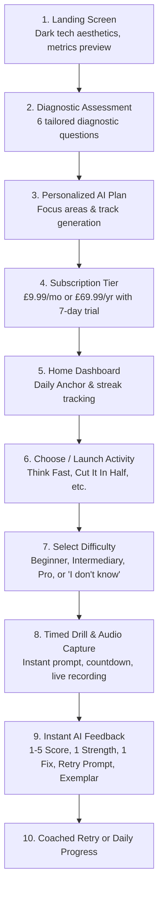

# Hakkiri — Product Requirements Document (PRD)

## 1. Executive Summary
**Hakkiri** is a daily communication gym mobile application engineered to help working professionals, graduates, executives, and lifelong learners practice thinking and speaking under real-world pressure. 

Unlike traditional speech therapy or generic language apps, Hakkiri targets professional communication breakdowns: unscripted executive presence, cognitive agility, active synthesis, message calibration, and conciseness. 

Evidence indicates that conversational breakdowns, information siloing, and miscalibrated messaging cost organizations billions annually and lead to critical medical and operational errors ([PMC6694717](https://pmc.ncbi.nlm.nih.gov/articles/PMC6694717/)). Hakkiri builds the neuromuscular and cognitive habits required to excel in high-stakes corporate and professional settings.

---

## 2. Core Value Proposition & Audience

### 2.1 Target Audiences
- **Early-Career & Recent Graduates**: Transitioning from memorized exam answers to unscripted, bottom-line-up-front (BLUF) workplace communication.
- **Mid-Level Professionals**: Leading cross-functional team syncs, pitching ideas, and negotiating project deadlines.
- **Senior Executives & Founders**: Delivering board updates, fundraising pitches, media appearances, and crisis communications.
- **Global & Cross-Functional Communicators**: Engineers, data scientists, and healthcare workers explaining deep domain concepts to non-technical stakeholders.

### 2.2 The Communication Gym Metaphor
- **Build an idea**: Instant mental retrieval and framing.
- **Organize it**: Frameworks, 3-part arcs, and thematic bucketing.
- **Find the right words**: Active verbs, zero filler phrases, high semantic density.
- **Speak**: Timed, high-stakes simulated delivery.
- **Receive useful feedback**: 1–5 scoring on executive presence, conciseness, engagement, and clarity.
- **Try again**: Iterative deliberate practice with coached retries.

---

## 3. User Journey & Core Flow

---

## 4. Feature Specifications

### 4.1 Onboarding & Assessment
- **Voice Profile & Gender**: Biological vocal resonance selection (Male, Female, Non-Binary / Vocal Alignment).
- **Career Stage**: Student/Early Career, Mid-Level, Senior Executive/Founder, General Self-Learner.
- **Career Field**: Corporate & Finance, Tech & Product, Sales & Marketing, Healthcare & Education.
- **Speaking Confidence**: Anxious & Shaky, Moderately Confident, Highly Confident.
- **Core Roadblock**: Fast Talking & Mumbling, Excessive Fillers, Monotone Delivery, Accent Intelligibility.
- **Primary Goal**: Executive Presence, Anxiety Reduction, Spontaneous Debating, Diction & Stamina.

### 4.2 Home & Daily Anchor
- **Daily Anchor**: 2–3 personalized daily drills (e.g., 1 Think Fast + 1 Cut It In Half + 1 Explain It Simply).
- **Executive Presence Radar**: Real-time score (1–5) tracking Fluency, Clarity, Tone, and Conciseness.
- **Streaks & XP**: Separated strictly from skill performance scores.

### 4.3 Activity Engine (MVP Scope)
1. **Think Fast\*** (Impromptu cognitive agility; 3s countdown, 60s speech)
2. **Cut It In Half\*** (Rate compression; reading passage, 50%+ brevity summary)
3. **1 Minute Expert\*** (Spontaneous thesis & structural chunking)
4. **Explain It Simply\*** (Jargon elimination for calibrated persona)
5. **Storytelling Gym\*** (3-part executive narrative arcs)
6. **Connect the Dots\*** (Lateral cognitive bridging between 2 disparate topics)
7. **Debate Me\*** (Defending stance against adversarial pushes)

*Asterisk (\*) marks MVP activities.*

### 4.4 Post-MVP Roadmap (v2 & Beyond)
- Real-time conversational AI debate partner (WebSocket two-way voice streaming).
- Desktop & browser live meeting companion (Zoom, Google Meet, MS Teams integration).
- Meeting listening & airtime analysis.
- Domain packs: Sales negotiation, fundraising pitch, executive media training.
- Video, gaze, and body-language telemetry.
- Multi-language support and enterprise team administration dashboards.

---

## 5. Monetization & Pricing Model

| Plan | Price | Billing Period | Features |
|---|---|---|---|
| **Monthly Pro** | **£9.99** | Monthly recurring | Unlimited daily workouts, full analytics, all 7 MVP drills |
| **Annual Pro (Best Value)** | **£69.99** | Annually (£5.83/mo equivalent) | 7-day free trial, full historical radar trends, specialized prompt packs |
| **Enterprise / B2B** | Custom (£400–£600 / seat / yr) | Annual contract | Team benchmarking, aggregated analytics, manager dashboards |
