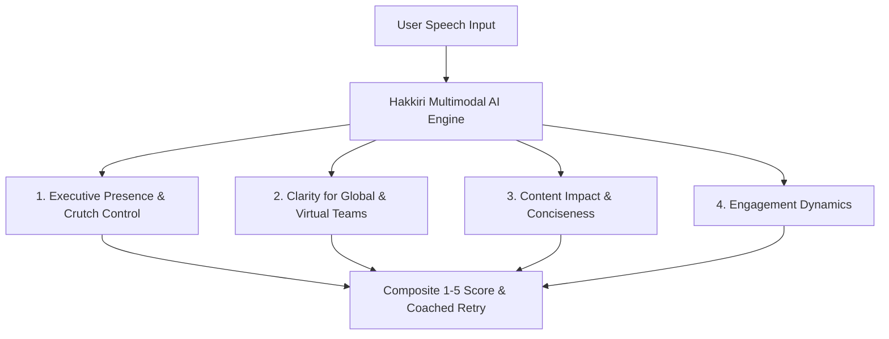

# Hakkiri — Scoring Engine & Feedback Architecture

## 1. Scoring Philosophy & Scale
All evaluations follow a standardized **1 to 5 scale**:
- **1: Not Demonstrated** — Roadblocks severely hinder communication.
- **2: Limited** — Inconsistent structure; frequent fillers; noticeable uptalk or rambling.
- **3: Partly Demonstrated** — Core point delivered, but lacks polish, framing, or pacing control.
- **4: Effective** — Professional, structured delivery with high clarity and minimal crutches.
- **5: Strongly Demonstrated** — Executive-tier composure, power pauses, crisp BLUF, and dynamic engagement.

---

## 2. The Four Core Evaluation Pillars

### Pillar 1: Executive Presence & "Crutch" Control (Fluency)
- **Up-talk Penalization**: Detects rising pitch inflection at sentence conclusions. Declarative statements ending in rising frequency sound like tentative questions, diminishing authority.
- **Corporate Crutch Detection**: Flags passive, permission-seeking phrases:
  - `"sort of"`
  - `"kind of"`
  - `"basically"`
  - `"essentially"`
  - `"does that make sense?"`
- **Deliberate Power Pausing**: Rewards intentional silences (1.0–2.0 seconds) positioned immediately before or after a thesis statement, signaling comfort with silence.

### Pillar 2: Clarity for Global & Virtual Teams
- **Virtual Audio Intelligibility**: Assesses consonant sharpness, plosives, and prevents sentence tail-off (volume dropping at the end of sentences).
- **Accent Intelligibility (Not Accent Reduction)**: Focuses exclusively on comprehensibility and syllable separation. Users are never penalized for native linguistic heritage.

### Pillar 3: Content Impact & Conciseness
- **Rambling Penalty (Brevity Score)**: Flags run-on clauses spanning >40–45s without syntactic breaks or structural transitions.
- **Action-Oriented Language Ratio**: Compares active verbs (`"We decided"`, `"Our team executed"`) against passive voice (`"It was determined"`, `"A decision was reached"`).

### Pillar 4: Engagement Dynamics (Anti-Monotone Check)
- **Energy Map**: Tracks dynamic variance in:
  - **Loudness (dB variance)**
  - **Fundamental Pitch (Hz variance)**
- Generates warnings when speech falls into flatline drone trajectories; rewards inflection peaks on key takeaways.

---

## 3. Strict Feedback Anatomy

Every post-activity evaluation modal **must** adhere strictly to this four-part schema:

1. **One Strength**: Highlighting a specific behavior executed effectively (e.g., *"Excellent 1.8s power pause before announcing your mitigation strategy"*).
2. **One Specific Improvement**: Pinpointing a single high-leverage correction (e.g., *"Replace the permission-seeking phrase 'does that make sense?' with a direct closing ask"*).
3. **Highlighted Phrase or Timestamp**: Exact transcript excerpt with time code (e.g., *`[00:23 - 00:28] "So basically, we kind of missed the mark..."`*).
4. **Clear Instruction for the Retry**: Actionable directive for the coached replay (e.g., *"In your next attempt, open with the decision in the first 5 seconds and maintain level pitch on the final syllable"*).

---

## 4. Fair Scoring Principles

1. **Do not penalize accents**: Intelligibility and comprehensibility supersede native accent erasure.
2. **Do not reward a single universal pace**: Natural cadence varies (120–170 wpm); score rhythm and variance, not arbitrary speed.
3. **Do not treat every filler word as failure**: A rare natural filler is acceptable; evaluate cluster density and habitual crutch reliance.
4. **Do not reward complex vocabulary for its own sake**: Prioritize cognitive clarity over verbose corporate jargon.
5. **Withhold judgment on poor audio quality**: If signal-to-noise ratio or transcription confidence drops below 75%, advise microphone adjustment rather than giving unfair low scores.
6. **Separate coached retry progress from fresh prompt progress**: Retries measure coaching receptivity, while new prompts measure intrinsic baseline agility.
7. **Keep streaks & XP separate from skill scores**: Gamification tracks consistency; 1–5 scores strictly reflect communication excellence.
